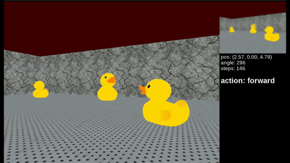
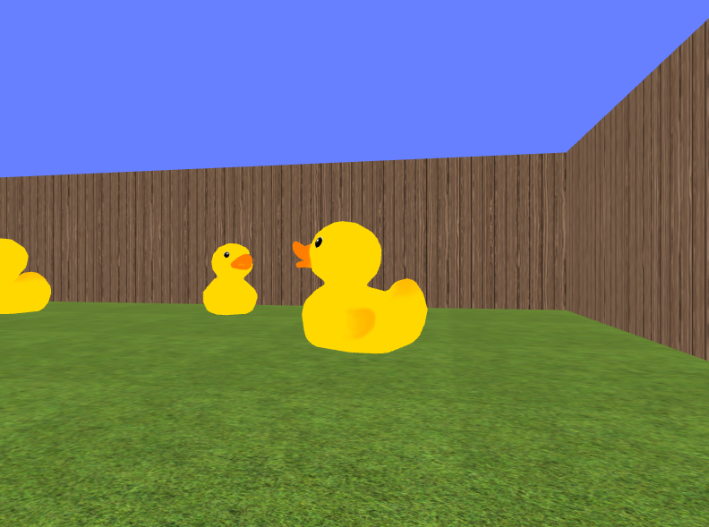
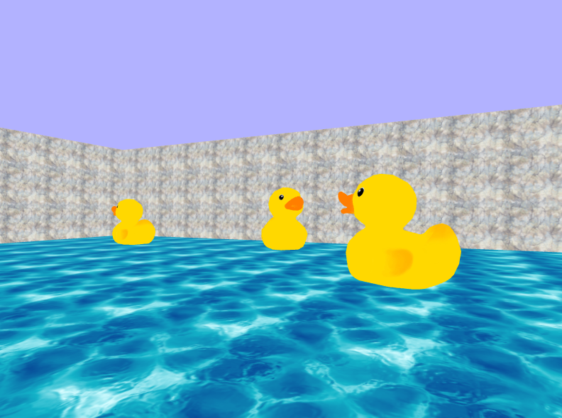
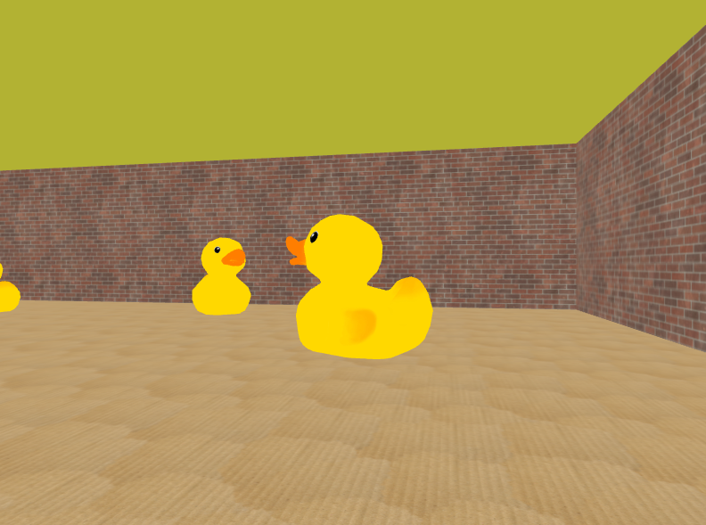
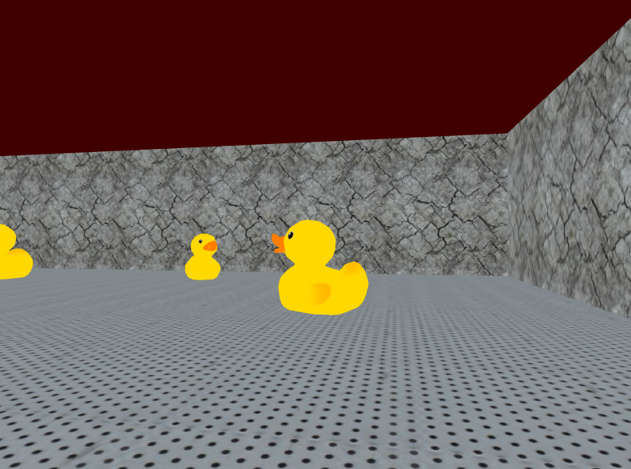

# Duck Collector using Imitation Learning



Compact imitation-learning policy for a small duck-collection game in
MiniWorld: a robot receives only its current RGB camera image and must decide
whether to turn left, turn right, or move forward to collect yellow duck objects.

We first played the game manually to generate expert demonstrations. Those
demonstrations became supervised training data: each camera frame is paired with
the action chosen by the human demonstrator. From there, we built a policy that
imitates the human strategy in closed-loop simulation.

## What We Built

The final solution combines hand-designed image analysis with a small neural
network policy. Instead of training directly on raw images, every frame is
converted into four interpretable features that describe where the yellow target
is in the robot's camera view:

- `centroid_x`: horizontal center of the largest detected yellow object
- `centroid_y`: vertical center of the largest detected yellow object
- `left_right_skew`: whether more yellow pixels appear on the left or right
- `yellow_quantity`: fraction of the image covered by yellow pixels

The image processing pipeline is deliberately simple and robust:

1. Threshold RGB pixels for yellow: high red, high green, low blue.
2. Use connected-component labeling to separate yellow blobs.
3. Keep the largest yellow component as the current target.
4. Compute centroid, yellow area, and left/right skew.
5. Feed those four features into the learned policy.

During development, we compared a classical non-neural baseline against a Keras
MLP. The MLP was selected because it was more responsive to minority actions
(`turn_left` and `turn_right`) than the baseline, which tended to over-predict
`move_forward` due to class imbalance.

## Generalization Setup

The model was trained and validated only on rooms `0`, `1`, and `2`. Room `3`
was kept fully unseen until the final test, so it measures whether the learned
policy transfers to new wall textures, floor textures, colors, and lighting.

| Room 0 | Room 1 | Room 2 | Room 3: unseen test |
|---|---|---|---|
|  |  |  |  |
| Training | Training | Training | Final unseen evaluation |

The final model is a compact Keras classifier:

- input: 4 engineered image features
- batch normalization
- dense layer with 32 ReLU units
- dense layer with 16 ReLU units
- 3-way softmax output: `left`, `right`, `forward`

## Results

Final closed-loop evaluation on the unseen test room:

```bash
python scripts/evaluate_policy.py \
  --room 3 \
  --runs 50 \
  --output outputs/runs/evaluation_room3_50runs.csv
```

| Metric | Room 3 Test Result |
|---|---:|
| Runs | 50 |
| Average success rate | 0.860 |
| Average objects collected | 4.30 / 5 |
| Median objects collected | 5 / 5 |
| Full-success runs | 30 / 50 |
| Runs with at least 4 objects | 41 / 50 |
| Object-count distribution | 1x2, 2x2, 3x5, 4x11, 5x30 |

The full per-seed evaluation is saved in
`outputs/runs/evaluation_room3_50runs.csv`, with a summary JSON next to it. A
tracked copy is included in [docs/results/evaluation_room3_50runs.csv](docs/results/evaluation_room3_50runs.csv).

For a complete write-up of the full development process, see the project
report: [docs/project_report.pdf](docs/project_report.pdf).

## Repository Layout

```text
.
├── src/duck_collector/      # environment, features, policy, training code
├── scripts/                 # command-line entry points
├── models/                  # saved Keras model
├── data/demonstrations/     # local demonstration pickles and manifest
├── docs/assets/             # README media
├── docs/results/            # tracked evaluation summaries
├── docs/                    # summary and Apptainer notes
├── containers/              # Apptainer definition
└── outputs/                 # generated videos and evaluation runs, ignored by Git
```

`outputs/runs/` is for generated evaluation artifacts such as CSV logs and JSON
summaries. It was empty before because the earlier evaluator only printed
results; it now writes run data when `scripts/evaluate_policy.py` is used.

## Setup

Create the project environment:

```bash
conda env create -f environment.yml
conda activate duck_collector
pip install -e .
```

If you are running on a headless machine, prefix simulator commands with:

```bash
xvfb-run -s "-screen 0 1280x720x24"
```

Apptainer instructions are in `docs/apptainer.md`.

## Run The Final Policy

Evaluate the pretrained model on the held-out test room:

```bash
python scripts/evaluate_policy.py --room 3 --runs 50
```

Watch a successful test rollout live:

```bash
python scripts/run_policy.py \
  --room 3 \
  --seed 1 \
  --max-steps 500 \
  --render \
  --delay 0.08 \
  --no-video
```

Export a video:

```bash
python scripts/run_policy.py \
  --room 3 \
  --seed 1 \
  --max-steps 500 \
  --video outputs/videos/room3_policy.mp4
```

## Retrain The Model

The default command uses all demonstration pickle files in the data directory:

```bash
python scripts/train_model.py \
  --data data/demonstrations \
  --pattern "*.pickle" \
  --output models/best_model.keras
```

To include every local recording:

```bash
python scripts/train_model.py --pattern "*.pickle"
```

A representative validation run achieved a macro-F1 of roughly `0.58` after
multi-environment training with softened class weights. Closed-loop performance is
reported above because it is the most relevant metric for the robot behavior.

## Collect New Demonstrations

Interactive recording uses the arrow keys in the MiniWorld window:

```bash
python scripts/collect_demonstrations.py 0 --path data/demonstrations
```

Only rooms `0`, `1`, and `2` should be used for training. Room `3` is reserved
as the held-out deployment scenario
